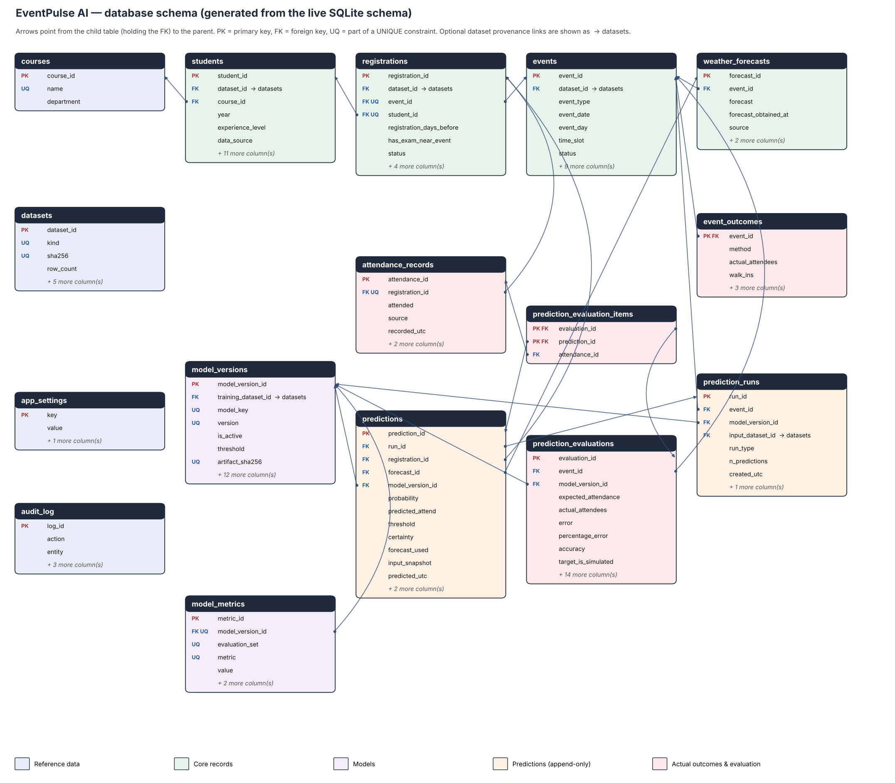

# EventPulse AI — Database design

SQLite, schema version 2 (migrations `0001_initial_schema`, `0002_indexes_and_views`).
File: `database/eventpulse.db`. Code: `core/db/`.

The diagram is generated from the live schema by `scripts/render_er_diagram.py`. A text version is in `er_diagram.mmd` (Mermaid; it renders in VS Code and on GitHub) and includes every column.

## 1. Tables and how they relate

### Core records
| Table | Purpose | Key relationships |
|---|---|---|
| `courses` | Lookup: programme → department | 1 course : N students |
| `students` | Pseudonymous student profile (the student-level model inputs) | N : 1 `courses` · 1 : N `registrations` |
| `events` | Event details: type, date, weekday, time slot, duration, venue, capacity, popularity, status | 1 : N `registrations`, `weather_forecasts`, `prediction_runs`, `prediction_evaluations` · 1 : 0..1 `event_outcomes` |
| `weather_forecasts` | **Forecast history** per event: the forecast value and **when it was obtained**, stored separately from the event | N : 1 `events` · predictions link to the forecast they used |
| `registrations` | A student registered for an event; the registration-level inputs (days before, exam proximity) and status | N : 1 `students`, N : 1 `events` · **UNIQUE (student_id, event_id)** · 1 : N `predictions` · 1 : 0..1 `attendance_records` |

`registrations` resolves the many-to-many relationship between students and events. Its unique constraint is what prevents duplicate student–event registrations.

### Models
| Table | Purpose | Key relationships |
|---|---|---|
| `model_versions` | Every trained artifact: version number, SHA-256, threshold, hyper-parameters, training data, library versions, active flag | 1 : N `model_metrics`, `predictions`, `prediction_runs`, `prediction_evaluations` · **UNIQUE (model_key, version)**, **UNIQUE (model_key, artifact_sha256)** · partial unique index ⇒ **at most one active model** |
| `model_metrics` | One row per metric per evaluation set (`cv`, `holdout`, `majority_baseline`, `split_sensitivity`), including the confusion-matrix cells | N : 1 `model_versions` |

### Predictions (append-only)
| Table | Purpose | Key relationships |
|---|---|---|
| `prediction_runs` | One row per prediction action (individual, bulk file, whole event) | N : 1 `model_versions`, optional N : 1 `events` / `datasets` · 1 : N `predictions` |
| `predictions` | **Probability, predicted outcome, threshold, certainty, model version, timestamp**, the forecast used and a JSON snapshot of the exact inputs | N : 1 `prediction_runs`, `model_versions` · optional N : 1 `registrations`, `weather_forecasts` |

A trigger rejects every `UPDATE` on `predictions`. Re-predicting adds new rows, so the **complete history** is kept, and `v_latest_predictions` returns the newest row per registration and model. Predictions for rows that are not stored registrations (what-if entries, uploaded files) keep pseudonymous `student_ref` / `event_ref` values instead of a registration link.

### Actual outcomes and evaluation
| Table | Purpose | Key relationships |
|---|---|---|
| `attendance_records` | **Actual** attendance per registration, kept apart from predictions. The `source` column distinguishes real entries (`MANUAL`, `UPLOAD`) from simulated ones (`ORIGINAL_SIMULATED`, `SYNTHETIC`) | 1 : 1 `registrations` (UNIQUE) |
| `event_outcomes` | Event-level result: method (`per_registration` / `headcount`), registered attendees, walk-ins | 1 : 1 `events` (PK = FK) |
| `prediction_evaluations` | **Stored predicted-vs-actual comparisons**: expected vs actual attendance, error, absolute and percentage error, count error, and per-student accuracy, balanced accuracy, Brier score, ROC-AUC and confusion matrix | N : 1 `events`, `model_versions` |
| `prediction_evaluation_items` | Exactly which predictions and actual records each evaluation used | composite PK (evaluation_id, prediction_id) |

### Support
`datasets` (every import with kind, file hash and row count; `Raw_Merged_Data` is refused by a CHECK) · `app_settings` (JSON key/value store for the Settings page) · `audit_log` (creates, updates, deletes, corrections, backups, restores) · `schema_migrations` (applied migrations with checksums).

### Views (read-only, used by prediction, analytics and the UI)
`v_registration_features` (one row per registration with the 20 model inputs under their model names, using the latest forecast or `Unavailable`) · `v_latest_forecast` · `v_latest_predictions` · `v_event_participation` (registrations, recorded attendance and the active model's expected attendance per event).

## 2. Integrity rules

| Rule | Enforced by |
|---|---|
| Foreign keys on every connection | `PRAGMA foreign_keys = ON` |
| No duplicate registration | `UNIQUE (student_id, event_id)` |
| One actual record per registration; one outcome per event | `UNIQUE (registration_id)`; `event_outcomes.event_id` primary key |
| Valid categories, ranges and 0/1 flags | `CHECK` constraints on every coded column |
| Previous attendance ≤ previous registrations | table `CHECK` on `students` |
| Weekday agrees with the calendar date | table `CHECK` on `events` using `strftime('%w')` |
| A real forecast states when it was obtained | `CHECK` on `weather_forecasts` (imported historical rows are exempt) |
| `predicted_attend` matches `probability ≥ threshold` | `CHECK` on `predictions` |
| Prediction history is immutable | `BEFORE UPDATE` trigger |
| Single active model | partial unique index |
| History cannot be deleted by accident | `ON DELETE RESTRICT` on history links, plus repository checks. Deleting an event with history needs `include_history=True` and is written to the audit log |
| No personal data | No PII columns exist. Repositories reject PII fields and IDs that look like e-mails, phone numbers or roll numbers, and the DB `CHECK` repeats the phone and roll-number patterns. The loader rejects PII columns and the `Raw_Merged_Data` sheet |

## 3. Actual attendance and prediction error

After an event, `services.record_actual_attendance(db, event_id, …)` accepts either:
- **per-student attendance** `{Student_ID: 0/1}` (partial entry is allowed; re-entering a value is a correction, logged with the old value), or
- **a head count** of registered students who attended,

plus optional **walk-ins**. Walk-ins are stored but excluded from the error, because only registered students are predicted. The event is marked `Completed` and then `evaluate_event` runs for every model version that predicted the event.

**Which predictions count:** for each active registration, the latest prediction by that model made **before the outcome was recorded and no later than the end of the event date**. Predictions made with hindsight are ignored.

| Quantity | Definition |
|---|---|
| Expected attendance | Σ predicted probabilities |
| Error | expected − actual (negative = under-predicted) |
| Absolute / percentage error | \|error\| and \|error\| ÷ actual × 100 |
| Count error | (registrations with probability ≥ threshold) − actual |
| Per-student metrics | accuracy, balanced accuracy, Brier score, ROC-AUC, TN/FP/FN/TP (only when per-student attendance was entered) |

Every evaluation is stored, including re-evaluations after corrections, and evaluations built on simulated outcomes are flagged `target_is_simulated = 1`. `services.model_accuracy_history()` excludes simulated evaluations by default, so real post-event evidence is never mixed with the simulated benchmark.

## 4. Migrations
- SQL files in `core/db/sql_migrations/NNNN_name.sql` are applied in order. Each runs in **one transaction**, so a failed migration rolls back completely.
- `schema_migrations` stores each file's SHA-256. If an applied file is edited later, startup is refused.
- Before migrating a database that already holds data, an automatic, verified backup is taken (`pre_migration_vX_to_vY`).
- A database from a newer app version is refused rather than damaged.
- Policy for future migrations: additive changes only (`CREATE`, `ALTER TABLE … ADD COLUMN`), or SQLite's create-copy-swap pattern that copies every row. Never drop data.

## 5. Backup and restore
- `backup_database()` uses SQLite's **online backup API**, which is consistent while the app is open. Every backup is **integrity-checked** after writing.
- `restore_database()` validates the file first: it must be readable, pass integrity checks, be an EventPulse schema and not be newer than the app. It then takes a `pre_restore` **safety backup** and copies the backup in. An older backup is migrated up to the current schema. If anything fails, the previous state is put back.
- `prune_backups(keep=N)` removes old routine backups and never removes safety backups.
- Command line: `python scripts/manage_db.py backup|list-backups|restore <file>`.

## 6. Errors and transactions
- `Database.transaction()` uses `BEGIN IMMEDIATE`. Nested blocks become SAVEPOINTs, so a multi-step operation (such as importing a dataset or recording attendance plus its evaluation) commits as one unit or not at all.
- Raw `sqlite3` errors are translated into `DuplicateRecordError`, `ConstraintViolationError`, `ReferenceError_`, `NotFoundError`, `HistoryProtectedError`, `PersonalDataError`, `MigrationError` and `BackupError`. Each carries a user-facing message, for example "This student is already registered for this event."
- The connection uses WAL journaling and a 5-second busy timeout.

## 7. How the desktop app will use it (Phases 4–6)
| Page | Main calls |
|---|---|
| Overview | `v_event_participation`, repository `count()`s, `ModelVersionRepository.active()` + `metrics()`, `PredictionRepository.history()` |
| Dataset Explorer | `services.import_file`, `DatasetRepository.list` |
| Event Management | `EventRepository`, `ForecastRepository`, `RegistrationRepository`, `services.record_actual_attendance` |
| Attendance Prediction | `services.predict_record`, `services.predict_event`, `services.predict_file` |
| Model Laboratory | `ModelVersionRepository` (+ `sync_models` after training), `model_metrics` |
| Analytics & Insights | views, `EvaluationRepository.history`, `services.model_accuracy_history` |
| Reports | all of the above (read-only) |
| Settings | `SettingsRepository`, backup/restore functions, `current_version` |
